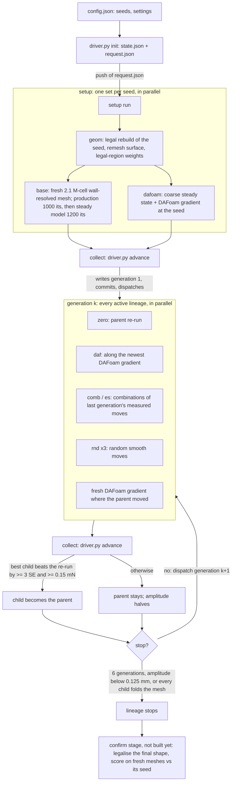

# Seeded hybrid: how it works

This is the plain-language guide. `README.md` in this folder is the formal record (settings, pass marks, change
log); this page explains what the machinery does, why each piece is there, and how to read and operate it.

## 1. What it is, in one paragraph

It improves the drag of the car's sidepod by **small, measured reshaping steps**. Each step tries a handful of
different ways to push the pod's surface in or out by up to a millimetre, measures every one with CFD, and keeps the
best one only if it is clearly better. One of those candidate directions comes from an **adjoint** (DAFoam), which
computes in one run which way every point of the surface should move to lower drag; the others are random or are
combinations of what was measured before. It does this from **three different starting shapes ("seeds") at once**, so
it can find out whether starting from a better or different pod ends better.

## 2. Why it exists

| Finding (where it is) | What it means for this workflow |
|---|---|
| The original hybrid loop's final pod is **10.4 mN** below the team pod surface it started from, confirmed on fresh meshes (`audit/RESULTS_b1.md`, T1) | Adjoint-led small steps work; worth building on |
| Seed evolution's best (d7) gained only **3.3 mN** over its start, at similar compute | For local improvement the adjoint-led loop is ~3x more effective |
| The team pod's *legal* rebuild reads **7.2 mN** less than the CAD surface the hybrid started from | The hybrid started from a worse surface than necessary; start it from legal seeds instead |
| The original hybrid moved the surface up to x = 200 mm, past the legal region (ends at 179 mm), and never went through the milling rules | Moves must stay in the legal region and the result must be re-legalised before any claim |
| DAFoam converged on only 1 of 6 shapes unlike the team pod | Whether the adjoint works on other seeds is unknown; this campaign measures it |

## 3. The ideas you need

- **Seed**: a starting pod shape, built legally (millable with the 6.35 mm ball end mill in 3 axes, 3 mm walls, one
  piece, cargo inside, ground clearance) by seed evolution's builder. Seeds here: `team` (the team pod, legally
  rebuilt), `d7` (seed evolution's best), `window` (a pod with through-openings).
- **Lineage**: one seed and everything descended from it. Lineages never mix.
- **Arm**: guided lineages use the adjoint; *no-adjoint* lineages (`team_noadj`, and one more chosen by a rule in
  `PROTOCOL.md` E2) share a guided lineage's seed, mesh and starting flow but never use the adjoint. Comparing the two
  is how the campaign tests whether the adjoint is the reason for the gain.
- **Parent / child / generation**: the parent is the lineage's current best shape. A generation makes several
  children, each = the parent plus **one** move. If a child wins, it becomes the next parent.
- **Move**: a smooth push of the surface along its normals, at most `amp` millimetres anywhere (the *amplitude*). Every
  move is built the same way so moves are comparable:
  - smoothed over 4.5 mm so it has no spikes,
  - faded to zero outside the legal sidepod region,
  - volume-neutral to first order (as much pushed in as out),
  - scaled so its peak is exactly `amp`,
  - kept 1.5 mm above the road.
- **Direction types** (what decides the move's pattern):
  - `daf`: the DAFoam adjoint gradient, i.e. "downhill" for drag according to the adjoint;
  - `rnd`: a random smooth pattern (the evolution part: blind trial);
  - `comb`: the best combination of all the directions measured in the previous generation;
  - `es`: the best combination of only the random directions measured in the previous generation.

  `comb` and `es` cost no adjoint: they learn from measurements already made.
- **Adjoint (DAFoam)**: one extra solve that gives the sensitivity of drag to moving each surface point. It runs on a
  coarse 105 k-cell mesh with a steady (first-order) flow model, because that is what fits in a runner's memory. On the
  team pod it got the sign of drag changes right 10 times out of 11 and overstated their size about 2x. So it is
  trusted for **direction only**; CFD decides every step.
- **Morphing instead of re-meshing**: each lineage builds **one** good mesh of its seed (about 2.1 M cells, with
  wall layers). Every child is scored by *bending that mesh* onto the child's shape, not by meshing it from scratch.
  Comparisons are then extremely precise (differences of 0.01 mN are visible) because the mesh is the same. The price:
  bending only works for about 2 mm in total before cells fold.
- **Chained morph**: the parent is a list of accepted moves ("levels"). A child's mesh is made by bending the base mesh
  through each level in turn, then by the child's own move.
- **Steady model vs production scheme**: children are solved with the *steady model* (first-order upwind for
  velocity), which settles to one answer, so small differences can be measured. The *production scheme* (second
  order) is the one used for final claims; it reads different absolute drag. Steady-model numbers are the loop's
  **internal yardstick only**.
- **SE (standard error)**: how much a measured drag value could wobble from the solver's own unsteadiness. The rule
  below asks for a win of at least 3 of them.

## 4. The flow

## 5. Stage by stage

### Setup (one run, about 5 hours)

For each seed, three jobs:

| Job | What it does | Time | Output |
|---|---|---|---|
| `geom <seed>` | Rebuilds the seed through the legal builder; remeshes its surface into even ~1 mm triangles (every move is defined per vertex of this surface); snaps the symmetry face to y = 0; computes how much of each vertex lies in the legal region | ~5 min | artifact `geom-<seed>` (the two surfaces), `<seed>_geom/geom.json` |
| `<seed>_base` | Meshes that surface once (fresh, wall-resolved, ~2.1 M cells); solves 1000 iterations with the production scheme, then 1200 with the steady model. Checks the steady model really settled (`steady_pass`: drag wanders <= 0.10 mN over the last 1000 iterations) | ~4.5-5 h | artifact `base-<seed>` (the mesh and flow every child starts from), `base.json` |
| `<seed>_daf_g0` | Coarse steady flow of the seed, then the DAFoam adjoint: the first gradient | ~1.5-2.5 h | `dafoam_sens.npz`, or nothing if DAFoam did not converge |

If a seed's base state fails, that lineage does not start. If only DAFoam fails, the lineage starts anyway, with two
extra random moves in place of the adjoint's.

### Each generation (one run, about 2-4 hours)

For each active lineage, up to 7 jobs at once:

| Child | Move | Why it is there |
|---|---|---|
| `zero` | none: the parent itself | The fair reference: measured in the same run, same way, as its children |
| `daf` | along the newest DAFoam gradient, at `amp` (generation 1 also at `amp/2`: `dafh`) | The adjoint's proposal |
| `comb` | best combination of all directions measured last generation | Learns from what was measured |
| `es` | best combination of only the random ones measured last generation | The same learning, adjoint-free: shows what evolution alone would do |
| `rnd` x3 | three new random smooth patterns | Exploration; also the adjoint-free baseline every generation |
| `<seed>_daf_g<k>` | (a gradient, not a child) | A fresh DAFoam gradient at the parent, used next generation, only if the parent moved since the last attempt |

Each child: build the move, bend the lineage's base mesh through the parent's levels and then the child's move, start
from the base flow, run 1000 steady-model iterations, and record drag as the mean of the last 404 with its SE.

## 6. One generation's decision, worked through

Illustrative numbers (half car, steady model):

| Child | Drag (mN) | SE | Change vs `zero` |
|---|---|---|---|
| `zero` | 186.00 | 0.10 | - |
| `daf` | 183.50 | 0.10 | **-2.50** |
| `rnd1004` | 185.60 | 0.12 | -0.40 |
| `comb` | 184.20 | 0.11 | -1.80 |

- Best child: `daf`, 2.50 mN below the parent's re-run.
- Is it clear? The combined SE is about sqrt(0.10^2 + 0.10^2) = 0.14 mN, and 3 SE is 0.42 mN. 2.50 is well past both
  0.42 and the 0.15 mN floor.
- So `daf` is accepted, and the parent becomes "seed + this DAFoam move". The amplitude stays.
- Every child's change (here -2.50, -0.40, -1.80) is saved as a measured direction. Next generation's `comb` and `es`
  are built from them.
- Had the best child been, say, -0.30 mN, it would fail the 3 SE test: the parent stays and the amplitude halves
  (the loop takes smaller steps when it cannot find a clear improvement).

The floor of 0.15 mN exists because two morphs of the same shape were seen to differ by ~0.14 mN, so a smaller "win"
could be a meshing artefact.

## 7. Where everything is

| File | What it is |
|---|---|
| `seedhybrid/config.json` | Seeds and settings: starting amplitude, minimum amplitude, floor, random moves per generation, generations, ESI off, auto-advance |
| `seedhybrid/request.json` | What the current or next run will compute (pushing a change to it starts a run) |
| `seedhybrid/state.json` | Every lineage's status, parent, amplitude, newest gradient, and each generation's children and verdict |
| `seedhybrid/lineages/<seed>/` | That lineage's gradients (`dafoam_g<k>.npz`), each generation's measured moves and combined directions (`g<k>/`), and every child's result and force history (`results/`) |
| `seedhybrid/driver.py` | The decision logic: reads results, applies the rule, writes the next request |
| `seedhybrid/prep.py` | Builds a seed's geometry on a runner |
| `seedhybrid/patch_adj.py` | The one change to the CFD code: confine moves to the legal region |
| `.github/workflows/seedhybrid.yml` | The jobs: setup, children, gradients, collect |
| `seedhybrid/README.md` | Formal record: pass marks and change log |

The CFD code itself is `mxnviir/stem-racing-adjoint` at commit `9ab9092`, checked out on every runner; nothing in
that repository is changed.

## 8. Operating it

- **Watch**: the Actions tab of this repository, workflow "seedhybrid". Each run is one stage. Each job's log ends
  with its result.
- **It advances by itself**: when a stage finishes, the collect job decides, commits, and starts the next stage.
- **Stop**: add a file `seedhybrid/STOP` to the branch. The current stage finishes and nothing new starts.
- **Restart**: delete `STOP` and start the workflow again (or ask me to).
- **Change a setting**: edit `config.json` before the generation it should affect, and add a dated line to the change
  log in `README.md` saying what changed and why. Changing settings after looking at results, then reporting only the
  good run, is the trap the audit warned about.

## 9. How to read the results

- In `state.json`, each lineage's `generations.<k>.result` holds the parent's re-run, every child's change, which
  child (if any) was accepted, and the best change.
- A lineage's progress is its list of accepted moves (`parent`) and the steady-model drag after each.
- **These are not the claim.** The steady model on a bent mesh is the loop's internal yardstick. The claim needs the
  confirm stage:
  1. the final shape goes back through the legal builder, because the moves are not milling-checked while the loop runs;
  2. it is scored the audit's way: fresh meshes, production scheme, four meshing frames;
  3. it is compared with its own legal seed, scored the same way.
- The data also shows which direction type earns its keep: in each generation every child starts from the same parent
  on the same mesh, so `daf`, `comb`, `es` and `rnd` are compared like for like. That tally is the evidence for or
  against using the adjoint.

## 10. Known limits

- **About 2 mm of total travel per lineage.** Bending a mesh further folds its cells. When every child folds, the
  lineage stops. Re-meshing the current parent and continuing ("phase B") is not built yet.
- **No confirm stage yet.** Until it exists, results are internal numbers only.
- **DAFoam may fail on seeds unlike the team pod.** Those lineages then run on random and recombined moves only.
- **One car, one sidepod region, drag only.** Race time is not used yet.

## 11. Glossary

| Term | Meaning |
|---|---|
| amplitude (`amp`) | the largest surface movement of a move, in mm |
| base mesh / base state | a lineage's one good mesh and the flow solved on it; every child is bent from it and starts from that flow |
| chained morph | bending the base mesh through each accepted move in turn |
| DAFoam | the discrete adjoint solver used for the gradient |
| ESI | OpenFOAM's continuous adjoint; removed from this workflow on 2026-11-28 (see `README.md` change log) |
| fold | a morph that turns cells inside out; that child is dropped |
| frame | a re-mesh of the same shape with the mesh grid shifted 0.37 mm; used in the audit to measure meshing noise |
| lineage | one seed and its descendants |
| production scheme | second-order flow model, used for claims |
| SE | standard error of a drag value |
| steady model | first-order flow model that settles; used inside the loop |
